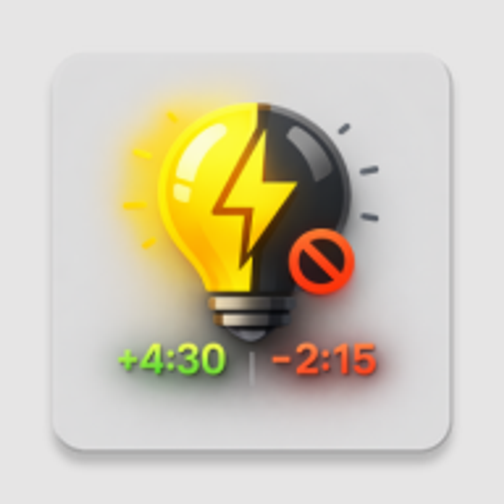

<h1 align="center">
  <br/>
Mobile App </h1>

> This Project is based on [Obytes starter](https://starter.obytes.com)

## Requirements

- [React Native dev environment ](https://reactnative.dev/docs/environment-setup)
- [Node.js LTS release](https://nodejs.org/en/)
- [Git](https://git-scm.com/)
- [Watchman](https://facebook.github.io/watchman/docs/install#buildinstall), required only for macOS or Linux users
- [Pnpm](https://pnpm.io/installation)
- [Cursor](https://www.cursor.com/) or [VS Code Editor](https://code.visualstudio.com/download) ⚠️ Make sure to install all recommended extension from `.vscode/extensions.json`

## 👋 Quick start

Clone the repo to your machine and install deps :

```sh
git clone https://github.com/user/repo-name

cd ./repo-name

pnpm install
```

To run the app on ios

```sh
pnpm ios
```

To run the app on Android

```sh
pnpm android
```

## Production APK

`pnpm build:production:apk` builds a signed APK with the production package `ua.svitlo.rn` and the Render backend. The app runs independently of Metro. This profile extends `production`; the existing `build:production:android` command still produces an AAB for Google Play.

Before building, log in to the project's Expo account. Configure the EAS `production` environment variable `GOOGLE_SERVICES_JSON` as a file containing the Firebase Android configuration for `ua.svitlo.rn`, and configure the matching FCM v1 credentials in EAS. The development package's Firebase configuration is different. Service-account private keys belong only in EAS credentials, never in the APK or public environment variables.

Download the APK from the EAS build page and open it on an Android device. Android may request permission to install apps from the browser or file manager. Keep the production signing key for future APK updates.

## ✍️ Documentation

- [Rules and Conventions](https://starter.obytes.com/getting-started/rules-and-conventions/)
- [Project structure](https://starter.obytes.com/getting-started/project-structure)
- [Environment vars and config](https://starter.obytes.com/getting-started/environment-vars-config)
- [UI and Theming](https://starter.obytes.com/ui-and-theme/ui-theming)
- [Components](https://starter.obytes.com/ui-and-theme/components)
- [Forms](https://starter.obytes.com/ui-and-theme/Forms)
- [Data fetching](https://starter.obytes.com/guides/data-fetching)
- [Contribute to starter](https://starter.obytes.com/how-to-contribute/)
